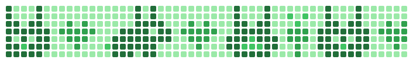

# cute-commit 🐰

A parade of bunnies, hearts and carrots on my GitHub contribution graph.



This is pixel art: the `bunny:` commits here are made by a script and are not real work.

## How it works

- The graph is 7 rows (Sunday to Saturday) by 53 weeks, so each day is one pixel of the parade.
- `bunny.py` works out today's shade, reads how many contributions the day already has, and adds
  only the commits still missing. Grass gets 1 commit, bunny fur gets 40.
- It runs every day at 21:30 Malaysia time. Missed days are filled in on the next run.
- The parade is tied to dates, so it hops left one column a week and repeats forever.

## Try it

```
python bunny.py preview
```

To change the art, edit `SPRITES`, `PARADE` and `COUNTS` at the top of `bunny.py`.

## Undo

Deleting this repository removes every bunny commit from the graph.
